# Harishankar Suresh

  

 

---

 

### About

Computer Science & Engineering undergraduate (**GEC Idukki**, 2024–2028) focused on **local AI inference**, **multimodal geospatial systems**, and **resource-constrained embedded architectures**.

- **Research & Engineering:** Multimodal deep learning (`EarthSense`), quantized local LLM/TTS pipelines (`Gomosy`), orbital mechanics (`TRACE`), and distributed microcontroller networks (`DAPS`).
- **Community:** Technical Coordinator at **IEEE Computer Society (GEC Idukki)** — leading workshops on Git Flow, REST APIs, Docker, and embedded C, and mentoring `100+` student engineers.

 

---

 

### Live GitHub Telemetry

 

  <table>
    <tr>
      <td align="center" valign="middle" width="420">
        
      </td>
      <td align="center" valign="middle" width="420">
        
      </td>
    </tr>
    <tr>
      <td colspan="2" align="center">
        
      </td>
    </tr>
  </table>

 

---

 

### Engineering Arsenal

  
  
  
  
  
  
  
  
  
  
  
  
  
  

| Domain                  | Stack & Capabilities                                                                                                         |
| :---                    | :---                                                                                                                         |
| **Languages**           | C, Python, Java, TypeScript, JavaScript, SQL, RISC-V Assembly                                                                |
| **AI, ML & Geospatial** | PyTorch (Multimodal Attention, LSTM), XGBoost, ONNX Runtime, llama.cpp (4-bit GGUF), Kokoro TTS, GeoPandas, Rasterio, Folium |
| **Backend & Systems**   | FastAPI, Spring Boot, Streamlit, REST/OpenAPI, Multi-threading, IPC, MQTT, Electron, Apache Parquet                          |
| **Infra & Data**        | Docker, GitHub Actions, Linux, PostgreSQL / PostGIS, Supabase, Vercel                                                        |

 

---

 

### Projects

| Project | Domain | Stack | Key Result |
| :--- | :--- | :--- | :--- |
| [**EarthSense**](https://github.com/ImNotHari/Earthsense) | Multimodal Landslide EWS | PyTorch, XGBoost, SAR, FastAPI, Streamlit | `0.9581` PR-AUC · `49.45 ms` p95 |
| [**Gomosy**](https://github.com/ImNotHari/gomosy) | Offline PDF-to-Speech AI | Python, Electron, ONNX, llama.cpp | `<= 1.0 GB` RAM · `<= 2.5 GB` VRAM |
| [**TRACE**](https://github.com/ImNotHari/TRACE) | LEO Orbital Decay Sim | JavaScript, Physics Modeling, Chart.js | `NASA Global Nominee` · `2025` |
| [**Expense Tracker**](https://github.com/ImNotHari/expensetracker) | Full-Stack Finance SPA | Spring Boot, PostgreSQL, Docker, Vue.js | `< 100 ms` indexed queries |
| **DAPS** | Embedded IoT Network | C, MQTT, I2C/SPI, Sensor Fusion | `~15%` power reduction |
| **RISC-V Predictor** | Microarchitecture Sim | QtRvSim, RISC-V Assembly, Python | `5-stage` pipeline CPI analysis |

<strong>Architectural Deep-Dives</strong>

 

- **[EarthSense](https://github.com/ImNotHari/Earthsense) — Multimodal Landslide Susceptibility & 24h Early Warning**
  - Fused Sentinel-1 SAR/MSI imagery, 5-day rainfall LSTMs, and terrain MLPs via Cross-Modal Multi-Head Attention over 1 km UTM grids (`0.9581` PR-AUC, `0.9901` ROC-AUC on 2020 Pettimudi holdout; `88.4%` Wayanad concordance).
  - Engineered a vectorized CPU serving pipeline (`49.45 ms` p95 across `4,496` cells), dual-gated OASIS CAP v1.2 / NDMA SACHET alerting, and `12` Papermill-gated notebooks.

- **[Gomosy](https://github.com/ImNotHari/gomosy) — Zero-Cloud PDF-to-Speech AI Studio**
  - Built an offline desktop narration engine combining PyMuPDF extraction, 4-bit GGUF `llama-cpp-python` cleaning, and Kokoro ONNX TTS over a non-blocking Electron–Python IPC bridge (`< 50 ms` UI updates).
  - Enforced explicit ONNX session disposal and chunked PCM-to-MP3 streaming, capping memory at `<= 1.0 GB` RAM and `<= 2.5 GB` VRAM.

- **[Project TRACE](https://github.com/ImNotHari/TRACE) — LEO Satellite Orbital Decay Simulation** *(NASA Space Apps 2025 Global Nominee)*
  - Implemented numerical integration models for atmospheric drag and ballistic decay across `120–450 km` LEO independent of TLE telemetry, with interactive Chart.js lifetime projections.

- **[Expense Tracker](https://github.com/ImNotHari/expensetracker) — Full-Stack Personal Finance Platform**
  - Designed normalized PostgreSQL schemas with JWT tenant isolation, Spring Boot REST microservices, and automated GitHub Actions + Docker CI/CD.

- **Distributed Air Purifier System (DAPS) & RISC-V Branch Prediction**
  - Authored C I2C/SPI firmware for PM2.5/PM10 sensors with MQTT load-balancing (`~15%` power savings); benchmarked BTFN vs. 1-bit/2-bit dynamic predictors on a `5-stage` RISC-V pipeline in QtRvSim.

 

---

 

### Current Focus

- **Edge & Geospatial AI:** Quantized inference runtimes, multimodal sensor fusion, and sub-50ms CPU serving.
- **Systems & Architecture:** Pipeline hazard analysis, deterministic IPC, and resilient low-bandwidth IoT telemetry.

 

  <code>Designed with restraint · Built for performance · github.com/ImNotHari</code>

